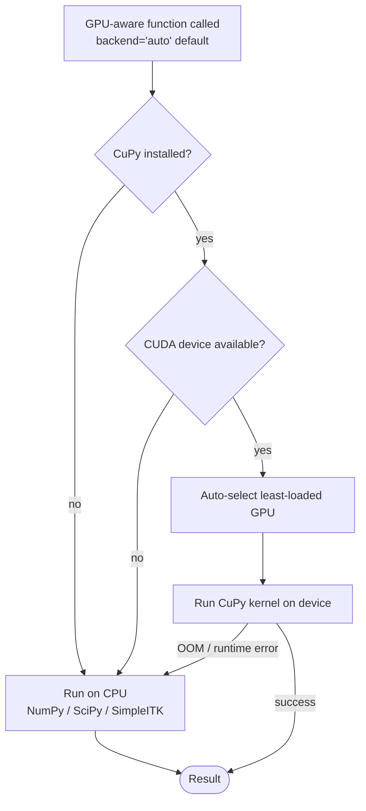

# GPU Acceleration


## Overview

linumpy supports GPU acceleration for compute-intensive operations using NVIDIA CUDA via CuPy. GPU acceleration is **optional** - all functions automatically fall back to CPU (NumPy/SciPy) if:

- CuPy is not installed
- No CUDA-capable GPU is available
- GPU memory is insufficient



backend selection is per-call (`backend="cpu" | "gpu" | "auto"`); the auto path is the safe default and is what the Nextflow workflows use when `use_gpu=true`.

---

## Quick Start

```bash
# Check your CUDA version
nvidia-smi | grep "CUDA Version"

# Install linumpy with GPU support (choose your CUDA version)
uv pip install 'linumpy[gpu]'           # CUDA 13.x (default)
uv pip install 'linumpy[gpu-cuda12]'    # CUDA 12.x

# Verify GPU
linum-gpu-info
linum-diagnose-pipeline --benchmark
```

---

## Installation

### Requirements

- NVIDIA GPU with CUDA Compute Capability 3.0+
- CUDA Toolkit 11.x, 12.x, or 13.x
- CuPy matching your CUDA version

**Recommended GPU:** NVIDIA A6000 (48GB) or similar professional GPU.

### CuPy Version Reference

| CUDA Version | CuPy Package | linumpy extra |
|--------------|--------------|---------------|
| CUDA 13.x    | `cupy-cuda13x` | `linumpy[gpu]` (default) |
| CUDA 12.x    | `cupy-cuda12x` | `linumpy[gpu-cuda12]` |

---

## BaSiCPy (fix_illumination)

The `fix_illumination` step uses BaSiCPy 2.x, which now ships with a
**PyTorch backend** (no JAX). BaSiCPy will use a CUDA-enabled PyTorch wheel
automatically when one is installed; otherwise it runs on CPU.

If you only need linumpy's CuPy paths (resampling, FFT, morphology, N4),
no extra steps beyond `pip install 'linumpy[gpu]'` are required. To enable
GPU acceleration of BaSiCPy as well, install a CUDA build of PyTorch:

```bash
# Pick the index URL that matches your CUDA toolkit
uv pip install torch --index-url https://download.pytorch.org/whl/cu121
```

Verify:

```bash
linum-gpu-info
linum-diagnose-pipeline --benchmark
```

---

## GPU-Accelerated Scripts

All scripts now accept `--use_gpu` / `--no-use_gpu` (default: `--use_gpu`).
GPU acceleration is enabled automatically when a CUDA device is detected; no
separate `_gpu.py` variant is needed.

| Script | GPU-accelerated operation | Typical Speedup |
|--------|--------------------------|-----------------|
| `linum-estimate-transform` | FFT / phase correlation | 8-47x |
| `linum-create-mosaic-grid-3d` | Volume resize | 5-12x |
| `linum-resample-mosaic-grid` | Volume resize | 5-12x |
| `linum-normalize-intensities-per-slice` | Gaussian filter, Otsu threshold | 4-10x |
| `linum-fix-illumination-3d` | BaSiCPy via PyTorch/CUDA | 2-5x |
| `linum-assess-slice-quality` | SSIM, morphology | 3-8x |
| `linum-aip-png` | Mean projection | ≤1x |
| `linum-generate-mosaic-aips` | Mean projection | ≤1x |
| `linum-correct-bias-field` | N4 bias field estimation | varies |
| `linum-estimate-global-transform` | Phase correlation | 8-16x |

---

## GPU-Accelerated Operations

### Major Improvements (7-70x speedup)

| Operation | Function | Typical Speedup |
|-----------|----------|-----------------|
| Binary Morphology | `binary_closing()`, etc. | 7-67x |
| FFT/iFFT | `fft2()`, `ifft2()` | 9-47x |
| Gaussian Filter | `gaussian_filter()` | 7-20x |
| Phase Correlation | `phase_correlation()` | 8-16x |
| Resampling | `resize()` | 5-12x |

### Medium Improvements (4-10x speedup)

| Operation | Typical Speedup |
|-----------|-----------------|
| Normalization | 4-10x |
| Percentile Clipping | 4-10x |
| Interpolation | 5-10x |
| Mask Creation | 2-4x |

### No GPU Benefit (use CPU)

| Operation | Reason |
|-----------|--------|
| Mean/Max Projection | Simple reduction, transfer overhead dominates |
| Galvo Detection | Simple computation |

---

## CuPy acceleration backends (`CUPY_ACCELERATORS`)

CuPy can route some array ops through additional NVIDIA backends. By default CuPy
enables only `cub`; adding `cutensor` lets CuPy use the cuTENSOR backend for
`tensordot`/`einsum` (the GPU B-spline / bias-field path in `linumpy.gpu.bspline`).
cuTENSOR ships with the CUDA toolkit, so no extra install is needed.

The Nextflow pipelines expose this via the `cupy_accelerators` param (default
`'cub,cutensor'`), exported as `CUPY_ACCELERATORS` into every task:

```bash
# Default (cuTENSOR enabled)
nextflow run workflows/reconst_3d/soct_3d_reconst.nf ...

# Fall back to CuPy's built-in default
nextflow run workflows/reconst_3d/soct_3d_reconst.nf ... --cupy_accelerators cub
```

Outside Nextflow, set the variable directly:

```bash
CUPY_ACCELERATORS=cub,cutensor linum-correct-bias-field ...
```

It only affects CuPy's `tensordot`/`einsum`; FFT phase correlation, morphology,
Gaussian filtering, and N4 already run on dedicated CuPy/cuFFT kernels regardless.

---

## Multi-GPU Systems

```bash
# Show status of all GPUs
linum-gpu-info --status

# Select best GPU (most free memory)
linum-gpu-info --select-best

# Use specific GPU via environment
CUDA_VISIBLE_DEVICES=1 nextflow run pipeline.nf --use_gpu true
```

---

## Memory Management

The NVIDIA A6000's 48GB VRAM typically holds entire mosaic grids. For larger volumes:

```python
import cupy as cp

# Clear GPU memory cache
cp.get_default_memory_pool().free_all_blocks()

# Check memory usage
mempool = cp.get_default_memory_pool()
print(f"GPU memory used: {mempool.used_bytes() / 1e9:.2f} GB")
```

---

## Troubleshooting

### GPU Not Detected

```bash
nvidia-smi
python -c "import cupy; print(cupy.cuda.runtime.getDeviceCount())"
linum-gpu-info
```

### BaSiCPy / PyTorch CUDA Issues

If `linum-fix-illumination-3d` falls back to CPU unexpectedly, verify the
PyTorch CUDA build is installed and visible:

```bash
python -c "import torch; print(torch.cuda.is_available(), torch.cuda.get_device_name(0))"
linum-diagnose-pipeline --debug-cuda
```

Reinstall PyTorch from the matching CUDA index URL (see the BaSiCPy section
above) if `torch.cuda.is_available()` returns `False`.

### Out of Memory

- Reduce batch size / chunk size
- Use `cp.get_default_memory_pool().free_all_blocks()` between operations
- Set `use_gpu=False` for specific operations

---

## Reference Benchmarks

Actual benchmarks on NVIDIA RTX A6000 (48GB):

| Operation | Image Size | CPU Time | GPU Time | Speedup |
|-----------|------------|----------|----------|---------|
| FFT2 | 2048×2048 | 207ms | 4.4ms | 47x |
| Phase Correlation | 2048×2048 | 3876ms | 240ms | 16x |
| Gaussian Filter | 2048×2048 | 79ms | 4.1ms | 20x |
| Binary Closing | 2048×2048 | 99ms | 1.5ms | 67x |
| Resize | 2048→1024 | 29ms | 3.4ms | 9x |
| Mean Projection | 100×2048×2048 | 71ms | 146ms | **0.5x** |

---

## Module Reference

```python
from linumpy.gpu import (
    GPU_AVAILABLE,      # bool: Is GPU available?
    CUPY_AVAILABLE,     # bool: Is CuPy installed?
    GPU_DEVICE_NAME,    # str: GPU name
    GPU_MEMORY_GB,      # float: GPU memory in GB
    to_gpu, to_cpu,     # Transfer functions
    print_gpu_info,     # Print info
)

# Submodules
from linumpy.gpu.fft_ops import fft2, ifft2, phase_correlation
from linumpy.gpu.interpolation import resize, affine_transform
from linumpy.gpu.morphology import binary_closing, gaussian_filter
from linumpy.gpu.array_ops import normalize_percentile, clip_percentile
from linumpy.gpu.zarr_io import read_zarr_to_gpu
```

---

## Fast zarr → GPU loading

For zarr arrays on local NVMe, `linumpy.gpu.zarr_io.read_zarr_to_gpu` is the recommended entry point. It dispatches to the fastest backend available at runtime:

```python
from linumpy.gpu.zarr_io import read_zarr_to_gpu

dev = read_zarr_to_gpu("/scratch_nvme/volume.zarr")
# dev is a cupy.ndarray
```

Backend implementations live in their own modules:

- `linumpy.gpu.kvikio_zarr` — kvikio / GPUDirect Storage reader (uncompressed zarr v2/v3 only).

Selection order (when `prefer="auto"`):

1. **kvikio (GPUDirect Storage, native mode)** — chunks DMA'd directly from NVMe into GPU memory. Fastest. Requires `kvikio` installed, GDS native mode enabled (`/etc/cufile.json`: `allow_compat_mode=false`), and an uncompressed zarr.
2. **`zarr.config.enable_gpu()`** — host I/O with on-host decode, single H→D copy. Works for any zarr (compressed or not) and is the automatic fallback when GDS is unavailable, in compat mode, or the array is compressed.

You can force a specific path with `prefer="kvikio"` or `prefer="zarr-gpu"`. The legacy `cupy.asarray(zarr.open_array(...)[:])` path is kept only as a reference baseline in `linum-benchmark-kvikio-zarr`.

### Reference benchmark

`scripts/utils/linum_benchmark_kvikio_zarr.py` measures all three paths. On a 16 GiB float32 zarr v3 (256³ chunks) on local NVMe ext4 with an RTX A6000:

| Path | Cold | Warm |
|---|---|---|
| kvikio (GDS native) | 8.2 GiB/s | **9.9 GiB/s** |
| `zarr.config.enable_gpu()` | 6.3 GiB/s | 7.1 GiB/s |
| `zarr → numpy → cupy.asarray` | 1.1 GiB/s | 2.8 GiB/s |

In compat mode (GDS bounce-buffer), kvikio drops to ~4 GiB/s — slower than the `zarr-gpu` path. The auto selector detects this via `kvikio.defaults.compat_mode()` and prefers `zarr-gpu` in that case.

### Installing the GDS path

```bash
# CuPy + linumpy GPU support
uv pip install 'linumpy[gpu]'           # CUDA 13.x (default)
uv pip install 'linumpy[gpu-cuda12]'    # CUDA 12.x

# kvikio (optional, only needed for the GDS fast path)
uv pip install 'linumpy[gds]'           # CUDA 13.x (default)
uv pip install 'linumpy[gds-cuda12]'    # CUDA 12.x
```

### Enabling native GDS

Native GDS additionally requires:

- A CUDA-aware filesystem on the source path (ext4 / xfs on local NVMe is fine; NFS, overlayfs, encrypted FS are not).
- `/etc/cufile.json`: `properties.use_compat_mode = false`.
- IOMMU disabled or in passthrough (`amd_iommu=off iommu=off` on AMD; `intel_iommu=off` on Intel).
- PCI P2PDMA support in the CUDA driver, which needs an open NVIDIA kernel module, a large GPU BAR1 (Resizable BAR) and the `NVreg_RegistryDwords` options described under *P2PDMA requirements* below.
- nvidia-fs DKMS module loaded with matching ABI; verify `dmesg | grep nvidia_fs` shows no "disagrees about version of symbol" or "no extended symbol version" messages after driver/kernel updates.

If any of these are missing, kvikio silently falls back to a POSIX bounce-buffer (compat mode) and `read_zarr_to_gpu` will route around it.

### Building nvidia-fs on Ubuntu 26.04 (kernel 7.0)

Stock nvidia-fs builds on kernel 7.0 without local patches: 2.29.4 added the kernel-7.0 compilation fixes, and 2.30.2 and 2.31.5 compiled without source patches on `7.0.0-42-generic` (2.31.5 only needed the Makefile symvers argument described below). The former `shell_scripts/server_setup/nvfs_kernel7_patch.sh` workaround is no longer needed and was removed.

The CUDA apt repo ships `nvidia-fs-dkms` (2.30.2 at the time of writing); newer releases are tagged at <https://github.com/NVIDIA/gds-nvidia-fs>. To install a newer tag by hand, copy `src/` to `/usr/src/nvidia-fs-<ver>`, reuse the packaged `dkms.conf` with `PACKAGE_VERSION` updated, then:

```bash
sudo dkms add -m nvidia-fs -v <ver>
sudo dkms build -m nvidia-fs -v <ver> -k <kernel>
sudo dkms install -m nvidia-fs -v <ver> -k <kernel>
sudo apt-mark hold nvidia-fs-dkms   # keep apt from re-adding the older version
```

**Building for a kernel you are not running:** `create_nv.symvers.sh` takes the NVIDIA symbol versions from the *running* kernel unless it is passed one. The `nv_symbols` target in the Makefile does not pass it, so a build for another kernel embeds the wrong CRCs and `modprobe nvidia-fs` fails with `disagrees about version of symbol nvidia_p2p_dma_map_pages` (`Invalid argument`). Either build while booted into the target kernel, or change the Makefile line to `./create_nv.symvers.sh $(KVER)`. The NVIDIA driver must already be installed for the target kernel.

The `nvidia-fs:warning: error retrieving numa node for device ...` messages are harmless on single-socket systems with no NUMA information (`numa_node=-1` for all PCI devices): when both devices are unknown, nvidia-fs treats them as local.

### P2PDMA requirements and diagnosis

On kernels with `CONFIG_PCI_P2PDMA` (and `block.nvme.use_pci_p2pdma = true` in `/etc/cufile.json`) GDS uses PCI P2PDMA, which depends on the CUDA driver exposing the GPU `pci_p2pdma` attribute. Check with:

```bash
/usr/local/cuda/gds/tools/gdscheck -p            # platform summary
/usr/local/cuda/gds/tools/gdscheck -f <file>     # "GPUDirect Storage not supported on current file" = no native GDS
```

For details, run any cuFile program with `logging.level = TRACE` in a copy of `cufile.json` (point `CUFILE_ENV_PATH_JSON` at it). The line `gpu attribute pci_p2pdma not supported ... CUDA_ERROR_NOT_SUPPORTED` means the driver is not exposing P2PDMA, and KvikIO will fall back to compat mode.

NVIDIA's GDS NVMe guide ([GDS Support for NVMe](https://docs.nvidia.com/deploy/gds-support-for-nvme/pdf/GDS_Support_for_NVME.pdf)) describes the P2PDMA path as requiring the open kernel module and static BAR1 with write-combine disabled, e.g. in `/etc/modprobe.d/nvidia-p2pdma.conf`:

```
options nvidia NVreg_RegistryDwords="RMForceStaticBar1=1;ForceP2P=0;RmForceDisableIomapWC=1;"
```

`ForceP2P=0` is NVIDIA's guidance for pre-Hopper GPUs (Ampere, e.g. A6000/A40). NVMe multipathing must also be off (`options nvme_core multipath=N` in `/etc/modprobe.d/nvme.conf`). Run `sudo update-initramfs -u -k $(uname -r)` after editing either file, then reboot.

Static BAR1 needs a large BAR1, so Resizable BAR (and Above 4G Decoding) must be enabled in the BIOS, and `NVreg_EnableResizableBar=1` may be needed.

**Two further gotchas found on the LIOM server (kernel 7.0.0-42, driver 615.71.10, nvidia-fs 2.31.5):**

- **Boot framebuffer on the GPU.** If the firmware initialises a GPU for the console (a monitor on its DisplayPort), `simpledrm`/`BOOTFB` claims the start of that GPU's BAR1. The NVIDIA driver then cannot register the BAR as P2PDMA memory for that GPU (`/sys/bus/pci/devices/<bdf>/p2pmem/available` is `0`, and cuFile logs `gpu attribute pci_p2pdma not supported`). Since cuFile needs every GPU to support P2PDMA, native GDS is disabled for all of them. Check `grep -E 'BOOTFB|simpledrm' /proc/iomem`; the fix used here is `initcall_blacklist=sysfb_init` on the kernel command line (the console then lives on the ASPEED/VGA output only). `dmesg` should show `added peer-to-peer DMA memory` for every GPU.
- **ext4 must list `data=ordered` in the mount table.** cuFile refuses ext4 files unless `data=ordered` appears explicitly in the mount options (`findmnt -T <path>`); a default mount that omits it fails with `EXT4 journal options not found in mount table`. `/scratch_nvme` has it in `/etc/fstab`; `/tmp` does not, so test GDS there rather than in `/tmp`.

**Status on the LIOM server (2026-10-29):** native GDS works with the settings above. Both RTX A6000s have a 64 GiB BAR1 (Resizable BAR and Above 4G Decoding enabled, CSM disabled in the BIOS), `gdscheck -p` reports `NVMe : p2pdma`, `gdscheck -f` on `/scratch_nvme` passes the read verification on both GPUs, and `gdsio -x 0` (GPUD) and `kvikio.CuFile` read/write verified data (KvikIO `is_compat_mode_preferred()` is `False`). Throughput is limited by the NVMe drive (about 5.8 GiB/s read and 2.7 GiB/s write with `gdsio`), and the POSIX bounce path (`gdsio -x 2`) measured the same sequential read rate on that drive, so do not expect GDS to beat it on single-drive sequential reads.
